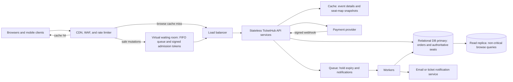

# TicketHub System Design

## 1. Requirements

### Functional requirements

- Visitors can browse and search events, view event details, and inspect a venue's seat map with current availability and prices.
- Registered users can join the sale queue, select available seats, place a temporary hold, pay for the held seats, and view their purchased tickets.
- A user can release a hold or let it expire. Expired or cancelled holds return their seats to sale.
- Users can only see their own orders and tickets. Administrators can publish events, configure seat inventory and prices, and monitor sales.
- Purchase and payment requests are idempotent, so retries do not create duplicate orders or charges.

### Non-functional requirements

- **Correctness:** A seat can have at most one active holder and at most one completed sale. The database, not a cache or browser view, is authoritative for availability.
- **Fairness:** Use a virtual waiting room with signed, time-stamped queue tokens and FIFO admission during a high-demand sale. Apply per-account purchase limits and bot/rate controls without letting clients skip ahead by refreshing or retrying.
- **Speed:** Cache event descriptions and static seat-map layouts at the CDN. Target under 300 ms p95 for cached browse requests and under 2 seconds p95 for hold responses while the sale is healthy. Show a clear waiting/queue state rather than timing out under overload.
- **Availability and recovery:** Run multiple stateless API instances across availability zones, retry idempotent background work, and back up the relational database. Keep payment-provider calls outside database transactions.
- **Security and privacy:** Require authentication for holds, checkout, orders, and tickets; authorize every order lookup; use TLS, payment-provider tokenization, and avoid storing card numbers.

## 2. Traffic estimates

### Assumptions

- TicketHub has 2,000,000 registered users. This is the account/data scale, not the number of daily active users; the normal-day traffic estimate uses the separately supplied 50,000 daily visitors.
- A normal day's 50,000 visitors each view 10 pages, for 500,000 page views/day. For a rough API estimate, assume one backend page-data request per page; static assets are served separately by the CDN.
- Average rates divide by 86,400 seconds/day. Normal busy-hour traffic is estimated at 10 times the daily average.
- During the popular sale, all 200,000 people arrive over 600 seconds. Each makes two reads (event and seat map) and one hold attempt. At most 20,000 people can proceed to payment; assume each winner makes one payment-initiation request. Add a 2x short-burst factor for sizing. These are planning estimates, not measured peaks.

| Workload | Calculation | Estimated rate |
| --- | --- | ---: |
| Normal page-data reads | `50,000 x 10 / 86,400` | `5.8 requests/second` average |
| Normal busy-hour page-data reads | `5.8 x 10` | `58 requests/second` |
| Normal tickets sold | `5,000 / 86,400` | `0.058 tickets/second` average (5,000 tickets/day; order count is not provided) |
| Popular-sale arrivals | `200,000 / 600` | `333 buyers/second` average for 10 minutes |
| Popular-sale event and seat-map reads | `200,000 x 2 / 600` | `667 requests/second` average |
| Popular-sale hold attempts | `200,000 / 600` | `333 requests/second` average |
| Payment initiation upper estimate | `20,000 / 600` | `33 requests/second` average |
| Total sale API estimate | `(400,000 + 200,000 + 20,000) / 600` | `1,033 requests/second` average; size for about `2,100 requests/second` with the 2x burst factor |

The sale has ten interested buyers per available seat (`200,000 / 20,000`), so no more than one in ten can obtain a seat if all seats are sold. The 1,033-request/second sale average is about 178 times normal average page-data traffic; the 2,067-request/second burst estimate is about 36 times the 58-request/second normal busy-hour estimate. The waiting room controls admission to a rate the system can sustain; it does not create more seats. Payment traffic depends on actual holds and must never be treated as guaranteed inventory.

At the estimated 2x burst, approximately 667 buyers/second could arrive. Each admitted buyer is assumed to make two reads and one hold request, or about 2,001 read/hold requests/second at that burst, plus up to 67 payment starts/second. I would initially cap admission at 600 buyers/second (about 1,800 read/hold requests/second) and tune it from a load test; that is a starting control, not a claim that the database has already been benchmarked. Raise or lower the cap only while p95 hold latency stays below 2 seconds, database lock waits remain within the agreed SLO, and error rates stay below the release threshold. If the test cannot sustain that rate, the queue slows admission and reports the wait instead of overloading seat writes.

## 3. API design

All endpoints use HTTPS and JSON. Authenticated endpoints derive the user identity from the session/token, not a client-supplied user ID. Use an `Idempotency-Key` header for hold and payment initiation. Return `409 Conflict` when a requested seat is no longer available, and include a retryable queue/wait response when admission is delayed.

| Method and endpoint | Purpose and success response |
| --- | --- |
| `GET /api/events?query=&cursor=&limit=` | Search published events; `200` with a page and next cursor. Invalid pagination returns `400`. |
| `GET /api/events/{eventId}` | Return event details, sale times, venue, and sale status (`200`); unknown event returns `404`. |
| `GET /api/events/{eventId}/seats?section=` | Return seat layout, price, and an availability snapshot (`200`). This is advisory; the hold endpoint decides ownership. Unknown event returns `404`. |
| `POST /api/events/{eventId}/holds` | Authenticated, queue-admitted request with `seatIds` and `Idempotency-Key`; atomically hold all requested seats or none. Returns `201` with `orderId` and `holdExpiresAt`. Returns `409` if any seat is held/sold, `429` if admission is not granted, or `400` for invalid input. |
| `DELETE /api/orders/{orderId}/hold` | Release the caller's still-active hold (`204`). Returns `403` for another user's order and `404` when missing/expired. Safe to retry. |
| `POST /api/orders/{orderId}/payment` | Start payment for a valid hold using the payment provider; `202` with `paymentStatus: "pending"` and a checkout URL. Returns `402` for a provider decline while the hold remains valid, or `409` for an expired hold. Idempotent for a given key. |
| `GET /api/me/tickets` | Return the authenticated user's paid tickets (`200`); unauthenticated calls return `401`. |
| `POST /api/payments/webhook` | Verify provider signature and process payment events idempotently; return `200` for a new or duplicate valid event, `400` for an invalid signature. This endpoint is not called directly by browsers. |

### Example requests and responses

```http
POST /api/events/evening-jazz/holds HTTP/1.1
Authorization: Bearer <session-token>
Idempotency-Key: 9a49c7d2-9c06-4dc9-a0fb-1023048a5fda
Content-Type: application/json

{"seatIds":["A-12","A-13"]}
```

```http
HTTP/1.1 201 Created
Content-Type: application/json

{"orderId":"ord_731","seatIds":["A-12","A-13"],"status":"held","holdExpiresAt":"2026-11-20T20:05:00Z"}
```

When another buyer owns one of those seats, no partial hold is created:

```http
HTTP/1.1 409 Conflict
Content-Type: application/json

{"code":"SEAT_UNAVAILABLE","message":"One or more seats are no longer available.","unavailableSeatIds":["A-12"]}
```

Payment initiation returns `202 Accepted` while the provider processes the payment; only a verified provider event changes the order to paid. Repeating the same hold or payment request with the same idempotency key returns the original result, not a second order or charge.

The runnable prototype in `day8/demo/` exercises browse, seat maps, holds, release, simulated checkout, tickets, and a real `409` conflict using in-memory state. It deliberately does not take payments or persist inventory across server restarts; the API and database below describe the production design.

The hold response is based on a committed database transaction. A seat-map response may be slightly stale because it can be cached; clients must handle a hold conflict and choose again. Payment is finalized only after a verified provider success event and another ownership/expiry check against the order's held seats.

## 4. Data model

Use PostgreSQL 16 because seat inventory, orders, and payment state have strict relationships and need row-level locks, constraints, and atomic transactions. IDs below are primary keys; foreign keys are enforced by the database.

| Table | Typed columns and constraints |
| --- | --- |
| `users` | `user_id BIGINT PRIMARY KEY`, `email VARCHAR(320) NOT NULL UNIQUE`, `password_hash TEXT NOT NULL`, `created_at TIMESTAMPTZ NOT NULL`. One user can create many orders. |
| `events` | `event_id UUID PRIMARY KEY`, `title VARCHAR(200) NOT NULL`, `venue VARCHAR(200) NOT NULL`, `starts_at TIMESTAMPTZ NOT NULL`, `sale_opens_at TIMESTAMPTZ NOT NULL`, `status VARCHAR(16) NOT NULL CHECK (status IN ('draft','published','cancelled'))`. One event has many seats and orders. |
| `orders` | `order_id UUID PRIMARY KEY`, `user_id BIGINT NOT NULL REFERENCES users`, `event_id UUID NOT NULL REFERENCES events`, `status VARCHAR(16) NOT NULL CHECK (status IN ('pending','paid','cancelled','expired','refund_pending'))`, `idempotency_key UUID NOT NULL`, `total_amount NUMERIC(10,2) NOT NULL CHECK (total_amount >= 0)`, `currency CHAR(3) NOT NULL`, `created_at TIMESTAMPTZ NOT NULL`, `hold_expires_at TIMESTAMPTZ`, `UNIQUE(user_id, idempotency_key)`. One order belongs to one user and one event; `total_amount` is the sum of its seat prices and service fees. |
| `seats` | `seat_id UUID PRIMARY KEY`, `event_id UUID NOT NULL REFERENCES events`, `section VARCHAR(20) NOT NULL`, `row_label VARCHAR(10) NOT NULL`, `seat_number SMALLINT NOT NULL CHECK (seat_number > 0)`, `price NUMERIC(10,2) NOT NULL CHECK (price >= 0)`, `status VARCHAR(12) NOT NULL CHECK (status IN ('available','held','sold'))`, `hold_order_id UUID REFERENCES orders`, `hold_expires_at TIMESTAMPTZ`, `UNIQUE(event_id, section, row_label, seat_number)`. A check constraint requires both hold fields only when `status = 'held'`; one row is one sellable seat. |
| `order_items` | `order_item_id UUID PRIMARY KEY`, `order_id UUID NOT NULL REFERENCES orders`, `seat_id UUID NOT NULL UNIQUE REFERENCES seats`, `price_paid NUMERIC(10,2) NOT NULL CHECK (price_paid >= 0)`, `service_fee NUMERIC(10,2) NOT NULL CHECK (service_fee >= 0)`, `created_at TIMESTAMPTZ NOT NULL`. One order can have many tickets; a seat can appear in at most one ticket. |
| `payments` | `payment_id UUID PRIMARY KEY`, `order_id UUID NOT NULL REFERENCES orders`, `idempotency_key UUID NOT NULL UNIQUE`, `provider_reference VARCHAR(100) UNIQUE`, `status VARCHAR(16) NOT NULL CHECK (status IN ('pending','succeeded','failed','refunded'))`, `amount NUMERIC(10,2) NOT NULL CHECK (amount >= 0)`, `created_at TIMESTAMPTZ NOT NULL`. Unique idempotency and provider references deduplicate requests and callbacks. |

An event has many seats; users have many orders; an order has many seats through `order_items`. `seats.hold_order_id` points to the pending order that currently owns a temporary hold. After payment succeeds, the seat becomes `sold`, its hold fields are cleared, and its durable ticket is represented by an `order_items` row. Expired or released holds clear `hold_order_id` and `hold_expires_at` and set the seat back to `available`; they do not create an `order_items` row.

Useful indexes include `events(status, sale_opens_at)`, `seats(event_id, section, status)`, `orders(user_id, created_at)`, and `order_items(order_id)`. Keep `order_items.seat_id` unique so even an application bug cannot create two completed ticket records for one seat. The seat hold-field check is `CHECK ((status = 'held' AND hold_order_id IS NOT NULL AND hold_expires_at IS NOT NULL) OR (status <> 'held' AND hold_order_id IS NULL AND hold_expires_at IS NULL))`.

## 5. Preventing double-booking

The database primary is the source of truth. Never reserve by first reading a cached `available` value and then writing later: two buyers could both see the same stale result. For a hold request, the service starts a short transaction, creates or reuses the idempotent pending order, and locks the requested seat rows in a stable ID order using `SELECT ... FOR UPDATE`. It verifies that every seat belongs to the event and is either available or has an expired hold. If any requested seat is held by another unexpired order or is sold, the transaction rolls back and returns `409`; it does not partially hold a multi-seat request.

If all seats pass, the transaction sets them to `held`, assigns `hold_order_id` and `hold_expires_at`, and commits. Row locks serialize competing requests for the same seats: the second transaction sees the first transaction's committed hold and cannot claim the seats. The conditional claim must be `WHERE status = 'available' OR (status = 'held' AND hold_expires_at < CURRENT_TIMESTAMP)`; the parentheses and held-state check are essential so a sold seat can never be reclaimed just because an old timestamp exists. Check the affected row count and roll back unless every requested seat was claimed. A database constraint requires a held seat to have a non-null hold order and expiry, while available/sold seats have neither.

Do not keep the database transaction open while a person enters payment details or while the service calls the payment provider. On a verified payment-success callback, use a new transaction to lock the order and its seats, confirm the order still owns every unexpired hold, insert `order_items`, mark seats sold, and mark the order paid atomically. `UNIQUE(order_items.seat_id)` is a final backstop. If the hold expired and was reassigned before payment success, do not take the new buyer's seat: mark the payment for refund/manual reconciliation and notify the original buyer. Payment callbacks and client retries use idempotency keys/provider references so duplicate events do not create duplicate tickets or charges.

## 6. Architecture



- **CDN:** Delivers static files and cacheable event/venue content near users, taking that traffic away from the API. Never cache a hold decision as authoritative.
- **WAF and rate limiter:** Blocks common abuse, applies per-account/IP limits, and protects APIs from malformed or excessive requests.
- **Virtual waiting room:** Assigns a signed FIFO admission token and admits buyers at a controlled rate. A queue token is checked on each sale mutation, preventing refreshes from jumping the line.
- **Load balancer and stateless API services:** Spread requests over multiple healthy instances. Stateless services can scale horizontally and coordinate holds through database transactions rather than in-process locks.
- **Cache:** Speeds up event details and seat-map snapshots. Short TTLs and invalidation improve freshness, but the hold transaction always rechecks the primary.
- **Relational DB primary:** Owns seat state, orders, holds, and ticket uniqueness. Row-level locks and constraints protect correctness under concurrent sale traffic.
- **Read replica:** Handles browse/report reads that tolerate replication lag; all sale decisions and writes go to the primary.
- **Payment provider:** Collects payment details and handles card processing so TicketHub does not store raw card data. Signed, idempotent webhooks report final outcomes.
- **Queue and workers:** Expire stale holds, send ticket notifications, and retry transient work without making the buyer wait for email delivery. Expiry is also checked synchronously during a competing hold, so a delayed worker cannot strand inventory.
- **Capacity response:** Normal page reads average about 6 requests/second (about 58/second at the assumed busy-hour multiplier). A popular sale is estimated at about 1,033 requests/second average and 2,067/second at the 2x burst. The initial 600-buyer/second admission ceiling limits the assumed three read/hold requests per admitted buyer to about 1,800/second; payment starts and other API calls use the remaining test budget. Load tests must validate that ceiling before a real sale, and the queue must lower it if p95 hold latency, database lock waits, or error rates breach their limits.

During the popular sale, the waiting room limits admitted requests to tested capacity, while CDN/cache layers absorb repeated reads. Multiple API instances handle admitted buyers; the database serializes only conflicting seat claims. Monitoring should track queue length/wait time, hold conflicts, database lock wait, payment errors, and sold/held counts. Autoscaling adds API and worker capacity, but database connection pools and admission limits must be bounded so scaling the front end does not overwhelm the primary.

## 7. Trade-offs

- **FIFO queue versus open access:** FIFO admission is understandable and reduces overload, but users may wait and a queue outage can block a sale. The system needs a durable queue position/token, clear status updates, and a documented policy for reconnects. A lottery is fairer when arrival-time advantages are undesirable, but is less predictable and harder to explain.
- **Strict primary transactions versus faster cached decisions:** Checking and locking seats on the database primary gives a strong no-double-booking guarantee, but increases write contention and can raise hold latency. A cache can accelerate browsing, but letting it authorize purchases would risk overselling; it remains advisory only.
- **Short hold expiry versus buyer convenience:** Short holds return abandoned seats quickly and reduce inventory hoarding, but can penalize slow users or payment-provider delays. A longer hold improves checkout completion but temporarily withholds seats; choose a measured expiry, show a countdown, and make late-payment handling explicit.
- **Synchronous ticket creation versus asynchronous payment notifications:** Finalizing the order and seats atomically in the payment webhook is consistent, while sending email asynchronously improves response reliability. The user may briefly see a paid order before the email arrives, so the ticket page must be the source of truth and notifications need retries.
