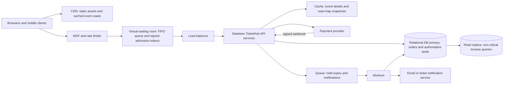

# TicketHub System Design

## 1. Requirements

### Functional requirements

- Visitors can browse and search events, view event details, and inspect a venue's seat map with current availability and prices.
- Registered users can join the sale queue, select available seats, place a temporary hold, pay for the held seats, and view their purchased tickets.
- A user can release a hold or let it expire. Expired or cancelled holds return their seats to sale.
- Users can only see their own orders and tickets. Administrators can publish events, configure seat inventory and prices, and monitor sales.
- Purchase and payment requests are idempotent, so retries do not create duplicate orders or charges.

### Non-functional requirements

- **Correctness:** A seat can have at most one active holder and at most one completed sale. The database, not a cache or browser view, is authoritative for availability.
- **Fairness:** Use a virtual waiting room with signed, time-stamped queue tokens and FIFO admission during a high-demand sale. Apply per-account purchase limits and bot/rate controls without letting clients skip ahead by refreshing or retrying.
- **Speed:** Cache event descriptions and static seat-map layouts at the CDN. Target under 300 ms p95 for cached browse requests and under 2 seconds p95 for hold responses while the sale is healthy. Show a clear waiting/queue state rather than timing out under overload.
- **Availability and recovery:** Run multiple stateless API instances across availability zones, retry idempotent background work, and back up the relational database. Keep payment-provider calls outside database transactions.
- **Security and privacy:** Require authentication for holds, checkout, orders, and tickets; authorize every order lookup; use TLS, payment-provider tokenization, and avoid storing card numbers.

## 2. Traffic estimates

### Assumptions

- TicketHub has 2,000,000 registered users. This is the account/data scale, not the number of daily active users; the normal-day traffic estimate uses the separately supplied 50,000 daily visitors.
- A normal day's 50,000 visitors each view 10 pages, for 500,000 page views/day. For a rough API estimate, assume one backend page-data request per page; static assets are served separately by the CDN.
- Average rates divide by 86,400 seconds/day. Normal busy-hour traffic is estimated at 10 times the daily average.
- During the popular sale, all 200,000 people arrive over 600 seconds. Each makes two reads (event and seat map) and one hold attempt. At most 20,000 people can proceed to payment; assume each winner makes one payment-initiation request. Add a 2x short-burst factor for sizing. These are planning estimates, not measured peaks.

| Workload | Calculation | Estimated rate |
| --- | --- | ---: |
| Normal page-data reads | `50,000 x 10 / 86,400` | `5.8 requests/second` average |
| Normal busy-hour page-data reads | `5.8 x 10` | `58 requests/second` |
| Normal completed orders | `5,000 / 86,400` | `0.058 orders/second` average (about 5,000/day) |
| Popular-sale arrivals | `200,000 / 600` | `333 buyers/second` average for 10 minutes |
| Popular-sale event and seat-map reads | `200,000 x 2 / 600` | `667 requests/second` average |
| Popular-sale hold attempts | `200,000 / 600` | `333 requests/second` average |
| Payment initiation upper estimate | `20,000 / 600` | `33 requests/second` average |
| Total sale API estimate | `(400,000 + 200,000 + 20,000) / 600` | `1,033 requests/second` average; size for about `2,100 requests/second` with the 2x burst factor |

The sale has ten interested buyers per available seat (`200,000 / 20,000`), so no more than one in ten can obtain a seat if all seats are sold. The estimated sale API load is about 178 times normal average page-data traffic and about 36 times the estimated normal busy-hour rate. The waiting room controls admission to a rate the system can sustain; it does not create more seats. Payment traffic depends on actual holds and must never be treated as guaranteed inventory.

## 3. API design

All endpoints use HTTPS and JSON. Authenticated endpoints derive the user identity from the session/token, not a client-supplied user ID. Use an `Idempotency-Key` header for hold and payment initiation. Return `409 Conflict` when a requested seat is no longer available, and include a retryable queue/wait response when admission is delayed.

| Method and endpoint | Purpose and result |
| --- | --- |
| `GET /api/events?query=&page=` | Search published events; supports pagination and cached responses. |
| `GET /api/events/{eventId}` | Return event details, sale times, venue, and sale status. |
| `GET /api/events/{eventId}/seats?section=` | Return seat layout, price, and an availability snapshot. This is advisory; the hold endpoint decides ownership. |
| `POST /api/events/{eventId}/holds` | Authenticated, queue-admitted request with `seatIds`. Atomically hold all requested seats for a short period (for example, five minutes), or none; return `orderId`, `holdExpiresAt`, and checkout details. |
| `DELETE /api/orders/{orderId}/hold` | Release the caller's still-active hold and make those seats available again. Safe to retry. |
| `POST /api/orders/{orderId}/payment` | Start payment for a valid hold using the payment provider; return a payment-session URL/status. Idempotent for a given key. |
| `GET /api/me/tickets` | Return the authenticated user's paid tickets and event details. |
| `POST /api/payments/webhook` | Verify the provider signature and process payment status events idempotently; this endpoint is not called directly by browsers. |

The hold response is based on a committed database transaction. A seat-map response may be slightly stale because it can be cached; clients must handle a hold conflict and choose again. Payment is finalized only after a verified provider success event and another ownership/expiry check against the order's held seats.

## 4. Data model

Use a relational database because seat inventory, orders, and payment state have strict relationships and need atomic transactions. IDs below are primary keys; foreign keys are enforced by the database.

| Table | Important columns and constraints |
| --- | --- |
| `users` | `id`, `email UNIQUE`, `password_hash`, `created_at`; one user can create many orders. |
| `events` | `id`, `title`, `venue`, `starts_at`, `sale_opens_at`, `status`; one event has many seats and orders. |
| `seats` | `id`, `event_id FK`, `section`, `row_label`, `seat_number`, `price`, `status`, `hold_order_id FK NULL`, `hold_expires_at NULL`; `UNIQUE(event_id, section, row_label, seat_number)`. One row represents one sellable seat. |
| `orders` | `id`, `user_id FK`, `event_id FK`, `status`, `idempotency_key`, `total_amount`, `created_at`, `expires_at`; `UNIQUE(user_id, idempotency_key)`. One order belongs to one user and one event. |
| `order_items` | `id`, `order_id FK`, `seat_id FK UNIQUE`, `price_paid`; one paid ticket per seat and one order can contain multiple tickets. The unique `seat_id` constraint is the final guard against selling a seat twice. |
| `payments` | `id`, `order_id FK`, `provider_reference UNIQUE`, `status`, `amount`, `created_at`; provider events and retries can be deduplicated by their unique reference. |

An event has many seats; users have many orders; an order has many seats through `order_items`. `seats.hold_order_id` points to the pending order that currently owns a temporary hold. After payment succeeds, the seat becomes `sold`, its hold fields are cleared, and its durable ticket is represented by an `order_items` row. Expired or released holds clear `hold_order_id` and `hold_expires_at` and set the seat back to `available`; they do not create an `order_items` row.

Useful indexes include `events(status, sale_opens_at)`, `seats(event_id, section, status)`, `orders(user_id, created_at)`, and `order_items(order_id)`. Keep `order_items.seat_id` unique so even an application bug cannot create two completed ticket records for one seat.

## 5. Preventing double-booking

The database primary is the source of truth. Never reserve by first reading a cached `available` value and then writing later: two buyers could both see the same stale result. For a hold request, the service starts a short transaction, creates or reuses the idempotent pending order, and locks the requested seat rows in a stable ID order using `SELECT ... FOR UPDATE`. It verifies that every seat belongs to the event and is either available or has an expired hold. If any requested seat is held by another unexpired order or is sold, the transaction rolls back and returns `409`; it does not partially hold a multi-seat request.

If all seats pass, the transaction sets them to `held`, assigns `hold_order_id` and `hold_expires_at`, and commits. Row locks serialize competing requests for the same seats: the second transaction sees the first transaction's committed hold and cannot claim the seats. Conditional updates (`WHERE status = 'available' OR hold_expires_at < CURRENT_TIMESTAMP`) and checking the affected row count provide an additional guard. A database constraint should ensure a held seat has a non-null hold order and expiry, while available/sold seats do not retain an active hold.

Do not keep the database transaction open while a person enters payment details or while the service calls the payment provider. On a verified payment-success callback, use a new transaction to lock the order and its seats, confirm the order still owns every unexpired hold, insert `order_items`, mark seats sold, and mark the order paid atomically. `UNIQUE(order_items.seat_id)` is a final backstop. If the hold expired and was reassigned before payment success, do not take the new buyer's seat: mark the payment for refund/manual reconciliation and notify the original buyer. Payment callbacks and client retries use idempotency keys/provider references so duplicate events do not create duplicate tickets or charges.

## 6. Architecture

- **CDN:** Delivers static files and cacheable event/venue content near users, taking that traffic away from the API. Never cache a hold decision as authoritative.
- **WAF and rate limiter:** Blocks common abuse, applies per-account/IP limits, and protects APIs from malformed or excessive requests.
- **Virtual waiting room:** Assigns a signed FIFO admission token and admits buyers at a controlled rate. A queue token is checked on each sale mutation, preventing refreshes from jumping the line.
- **Load balancer and stateless API services:** Spread requests over multiple healthy instances. Stateless services can scale horizontally and coordinate holds through database transactions rather than in-process locks.
- **Cache:** Speeds up event details and seat-map snapshots. Short TTLs and invalidation improve freshness, but the hold transaction always rechecks the primary.
- **Relational DB primary:** Owns seat state, orders, holds, and ticket uniqueness. Row-level locks and constraints protect correctness under concurrent sale traffic.
- **Read replica:** Handles browse/report reads that tolerate replication lag; all sale decisions and writes go to the primary.
- **Payment provider:** Collects payment details and handles card processing so TicketHub does not store raw card data. Signed, idempotent webhooks report final outcomes.
- **Queue and workers:** Expire stale holds, send ticket notifications, and retry transient work without making the buyer wait for email delivery. Expiry is also checked synchronously during a competing hold, so a delayed worker cannot strand inventory.

During the popular sale, the waiting room limits admitted requests to tested capacity, while CDN/cache layers absorb repeated reads. Multiple API instances handle admitted buyers; the database serializes only conflicting seat claims. Monitoring should track queue length/wait time, hold conflicts, database lock wait, payment errors, and sold/held counts. Autoscaling adds API and worker capacity, but database connection pools and admission limits must be bounded so scaling the front end does not overwhelm the primary.

## 7. Trade-offs

- **FIFO queue versus open access:** FIFO admission is understandable and reduces overload, but users may wait and a queue outage can block a sale. The system needs a durable queue position/token, clear status updates, and a documented policy for reconnects. A lottery is fairer when arrival-time advantages are undesirable, but is less predictable and harder to explain.
- **Strict primary transactions versus faster cached decisions:** Checking and locking seats on the database primary gives a strong no-double-booking guarantee, but increases write contention and can raise hold latency. A cache can accelerate browsing, but letting it authorize purchases would risk overselling; it remains advisory only.
- **Short hold expiry versus buyer convenience:** Short holds return abandoned seats quickly and reduce inventory hoarding, but can penalize slow users or payment-provider delays. A longer hold improves checkout completion but temporarily withholds seats; choose a measured expiry, show a countdown, and make late-payment handling explicit.
- **Synchronous ticket creation versus asynchronous payment notifications:** Finalizing the order and seats atomically in the payment webhook is consistent, while sending email asynchronously improves response reliability. The user may briefly see a paid order before the email arrives, so the ticket page must be the source of truth and notifications need retries.
